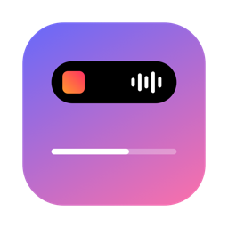
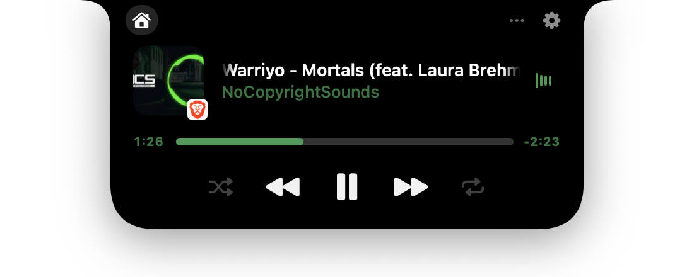
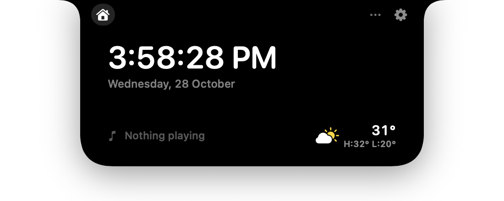
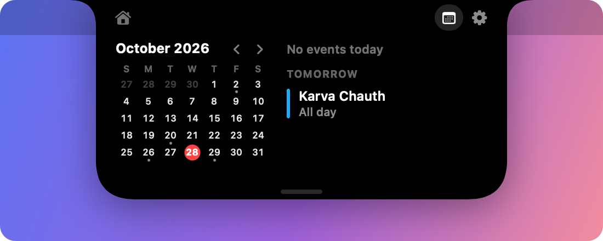
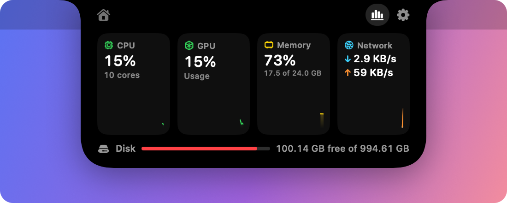
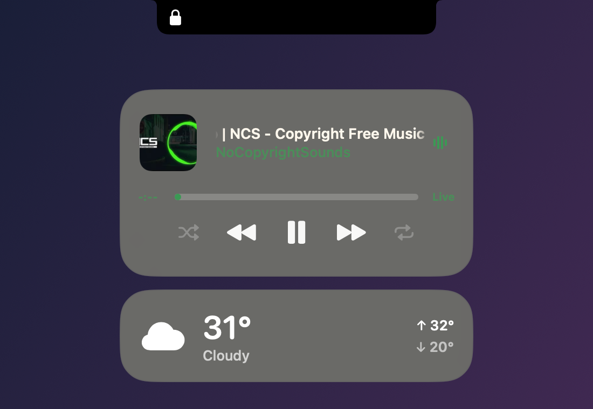
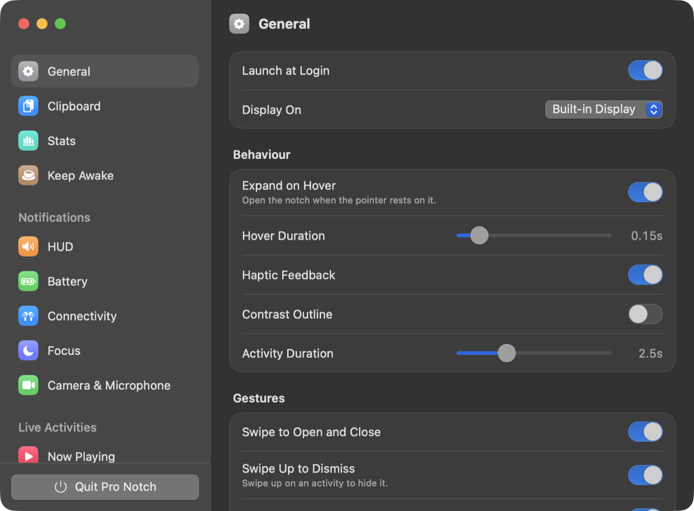
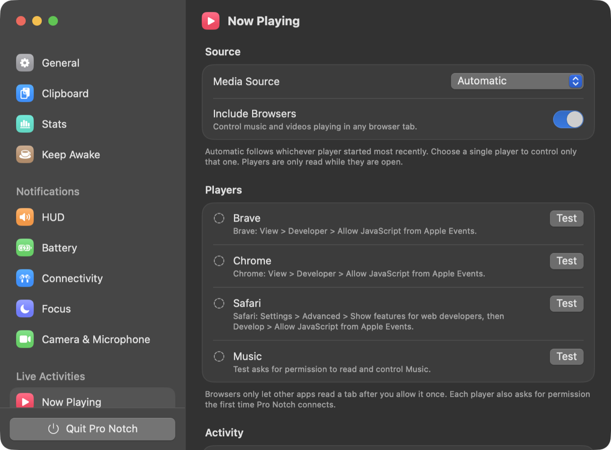
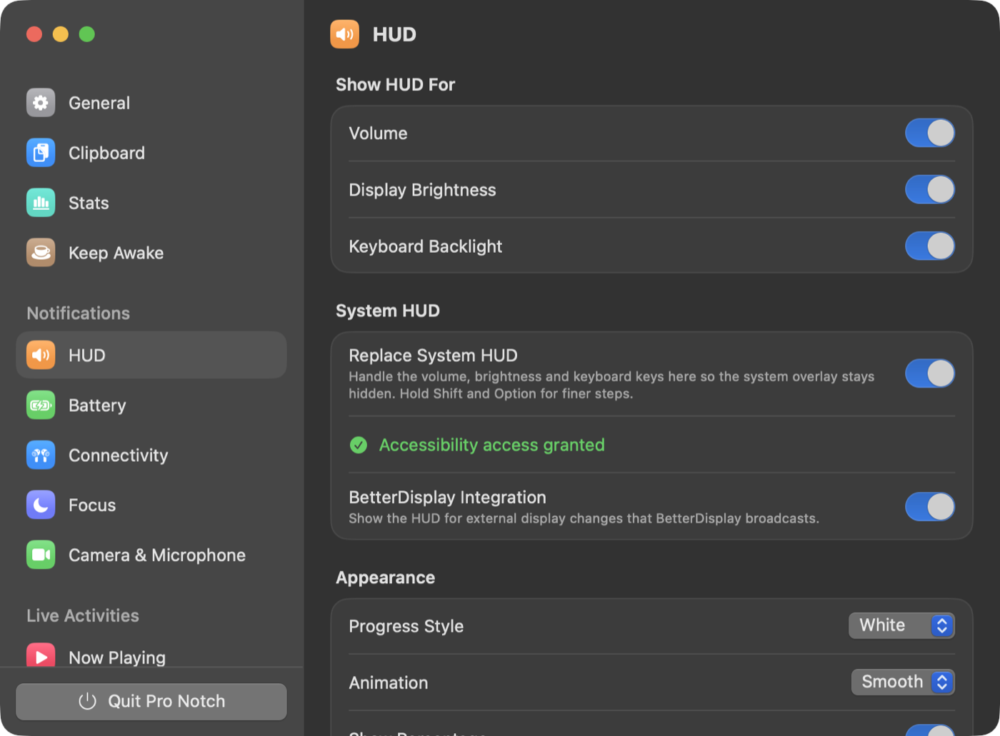
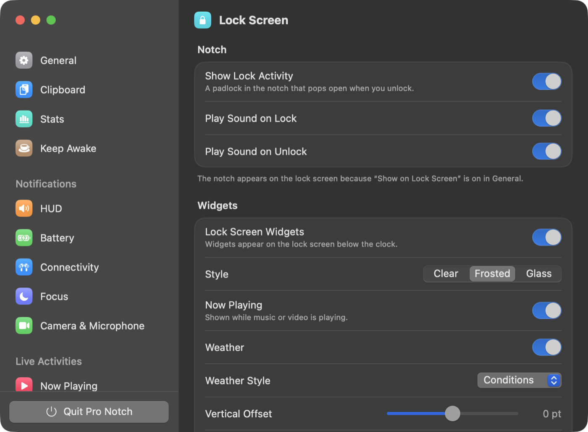

<p align="center">
  
</p>

<h1 align="center">Pro Notch</h1>

<p align="center">A Dynamic Island for the Mac notch: live activities, media controls, HUDs and more, right where your camera sits.</p>

<p align="center">
  <a href="https://github.com/bhushan-josh/pro_notch/releases/latest/download/ProNotch.dmg"></a>
</p>

<p align="center"><sub>macOS 15 or later · <a href="#download">install steps</a></sub></p>

> [!IMPORTANT]
> After dragging **Pro Notch** into Applications, run this once in Terminal. Pro Notch isn't notarized, so macOS blocks it until you do:
>
> ```bash
> xattr -dr com.apple.quarantine "/Applications/Pro Notch.app"
> ```

---

Pro Notch turns the MacBook notch into a black island that grows to show what's happening. Hover over it to open it, swipe it closed, and it stays out of the way the rest of the time. It's a native SwiftUI app for macOS 15 and later. On Macs without a notch it draws a simulated one.

## Features

**In the notch**
- **Now Playing**: artwork, controls and a live waveform for Music, Spotify and media in Brave, Chrome or Safari, plus synced lyrics under the notch.
- **Idle clock**: when nothing is playing, Home shows the time with seconds, the date, the weather and your next event. The player takes its place as soon as music starts (turn it off in **Settings → Now Playing**).
- **HUD**: replaces the system volume, brightness and keyboard backlight overlays, with level colors and optional percentages.
- **Calendar**: upcoming events on Home and a full month page, meeting links and "time to leave" alerts.
- **Downloads**: a progress ring in the notch while files download, with a page listing recent downloads.
- **Timers**: start timers from the notch and see them count down (turn on the tab in **Settings → Timers**).
- **Stats**: CPU, GPU, memory, network and disk usage.
- **Clipboard**: history of what you copied, kept between launches if you want.
- **Keep Awake**: a button in the open notch that stops your Mac from sleeping.

**Live activities and alerts**
- Battery: charging, low battery and Low Power Mode alerts.
- Connectivity: AirPods and other Bluetooth devices, with their battery levels.
- Focus mode changes.
- A padlock animation when you lock and unlock.

**Lock screen**
- Now Playing and weather widgets below the clock, in Clear, Frosted or Glass styles.

**Behaviour**
- Opens on hover or with a swipe, skips tracks with sideways swipes, and gives haptic feedback.
- Hides in fullscreen apps, in Mission Control and from screen recordings if you want.
- Works on your built-in display or any display you choose.

## Screenshots

<p align="center"></p>

<p align="center"></p>

<table>
  <tr>
    <td></td>
    <td></td>
  </tr>
</table>

<table>
  <tr>
    <td></td>
    <td></td>
  </tr>
</table>

<p align="center"></p>

<table>
  <tr>
    <td></td>
    <td></td>
  </tr>
  <tr>
    <td></td>
    <td></td>
  </tr>
</table>

## Download

**[Download Pro Notch (.dmg)](https://github.com/bhushan-josh/pro_notch/releases/latest/download/ProNotch.dmg)** · requires macOS 15 Sequoia or later.

1. Open `ProNotch.dmg` and drag **Pro Notch** into **Applications**.
2. Open Pro Notch from Applications.

Pro Notch isn't notarized by Apple, so the first launch is blocked with a message that macOS can't verify the app. To allow it, open **System Settings → Privacy & Security**, scroll down and click **Open Anyway** next to Pro Notch, then confirm. Or run this once in Terminal:

```bash
xattr -dr com.apple.quarantine "/Applications/Pro Notch.app"
```

## Build from source

You need:
- macOS 15 Sequoia or later.
- Xcode 16 or later, or the Swift 6 command line tools (`xcode-select --install`).

```bash
git clone https://github.com/bhushan-josh/pro_notch.git
cd pro_notch

# Optional, but recommended: a local signing identity, so macOS keeps
# your permission grants (Accessibility, Automation) across rebuilds.
scripts/create-signing-identity.sh

# Build and copy to /Applications, then launch.
scripts/build.sh --install
```

On first launch, Pro Notch walks you through the permissions each feature needs. You can change any of them later in **Settings → Permissions**:

| Permission | Used for |
| --- | --- |
| Accessibility | Taking over the volume, brightness and keyboard keys to replace the system HUD |
| Automation | Reading and controlling Music, Spotify and browser tabs |
| Calendars | Showing upcoming events |
| Location | Local weather and travel time to events |
| Bluetooth | Connected devices and their battery levels |
| Audio capture | Drawing the live waveform from what's playing |
| Downloads folder | Showing download progress and opening finished files |
| Full Disk Access | Reading which Focus mode is on |

To control media in Brave, Chrome or Safari, also turn on **Allow JavaScript from Apple Events** in the browser's Developer menu. The Now Playing settings page explains where to find it for each browser.

### Other build options

```bash
scripts/build.sh            # build to build/Pro Notch.app
scripts/build.sh --run      # build and launch from build/
scripts/build.sh --debug    # debug configuration (combine with --run or --install)
scripts/make-dmg.sh         # build and pack build/ProNotch.dmg for a release
```

## Using it

- **Open the notch**: hover over it, or swipe down on it.
- **More tabs**: tabs that don't fit in the header are behind the **⋯** button.
- **Settings**: click the gear in the open notch, or use the menu bar icon.
- **Quit**: use **Quit Pro Notch** at the bottom of the settings sidebar, or the menu bar icon.

You can also drive it with URLs, for example from Shortcuts or a terminal:

```bash
open "pronotch://open"               # open the notch
open "pronotch://open/calendar"      # open it on a page (home, calendar, clipboard, stats, timers, downloads)
open "pronotch://close"              # close it
open "pronotch://settings/hud"       # open settings on a page
```

## Project layout

Each feature is its own Swift package target and registers its pages, activities and settings with `NotchRegistry`:

```
Sources/
  ProNotch/        App shell: app delegate, menu bar item, settings window, onboarding
  NotchCore/       The island window, layout, animations, activity system and shared UI
  NotchMedia/      Now Playing, waveform, lyrics
  NotchHUD/        Volume, brightness and keyboard backlight HUD
  NotchSystem/     Battery, connectivity and Focus activities
  NotchCalendar/   Calendar page and event activities
  NotchLock/       Lock screen activity, widgets and weather
  NotchDownloads/  Download progress
  NotchTimers/     Timers
  NotchStats/      System stats
  NotchClipboard/  Clipboard history
  NotchKeepAwake/  Keep Awake toggle
```
